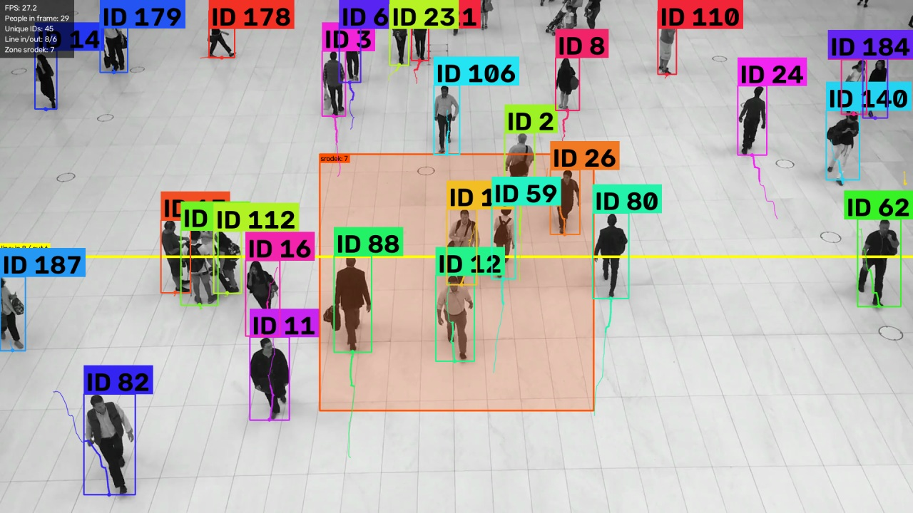
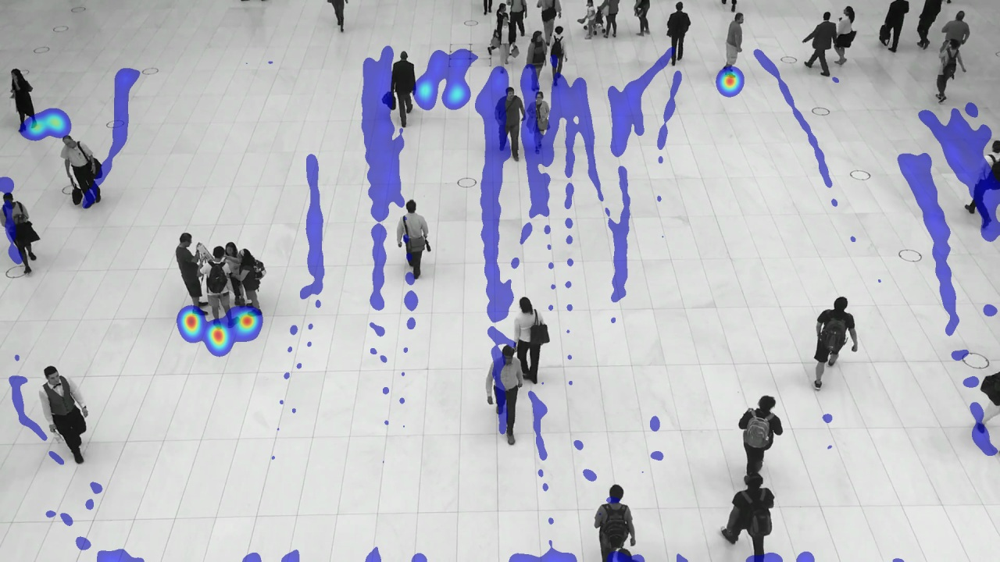

# System wykrywania, śledzenia i analizy ruchu pieszych

**Autorzy** Daniel Sterzel, Iwo Ropa, Anton Perakhod

**Data opracowania** 17 listopada 2026 r.

## 1. Cel i zakres projektu

Celem projektu było opracowanie systemu, który wykrywa osoby na nagraniu, przypisuje im identyfikatory i analizuje ich przemieszczanie się. Zastosowanie takiego rozwiązania pozwala ograniczyć ręczne przeglądanie materiału wideo przy badaniu natężenia ruchu, wykorzystania przestrzeni i liczby przejść przez wybrane miejsce.

System przedstawia ramki wykrytych osób, ich identyfikatory oraz trajektorie. Na podstawie kolejnych pozycji tworzy mapę cieplną, zlicza przekroczenia wirtualnej linii i monitoruje obecność osób w zdefiniowanych strefach. Wyniki udostępnia w podglądzie obrazu i zapisuje do dalszej analizy.

Przyjęliśmy pojedyncze źródło obrazu i śledzenie wielu osób w obrębie jednej sceny. Aplikacja obsługuje pliki wideo, kamerę lokalną i adres strumienia RTSP. Badania opisane w dokumentacji wykonaliśmy na plikach wideo. Punktem wyjścia były metody detekcji YOLO oraz śledzenia SORT, ByteTrack i BoT-SORT opisane w literaturze [1–4].

## 2. Wykrywanie osób za pomocą YOLO

YOLO, czyli *You Only Look Once*, jest rodziną detektorów obiektów wykorzystujących sieci neuronowe. Detektor analizuje całą klatkę i zwraca ramki otaczające obiekty, przypisane klasy oraz oceny pewności. Koncepcja pojedynczego przejścia sieci umożliwia stosowanie tych metod do przetwarzania sekwencji wideo [1, 5].

W projekcie analizujemy klasę `person`. Dla każdego wykrycia zapisujemy współrzędne ramki `(x1, y1, x2, y2)` i pewność detekcji. Pewność opisuje ocenę wykrycia człowieka przez model. Powiązanie wykrycia z osobą obserwowaną we wcześniejszych klatkach stanowi zadanie trackera.

Początkowo korzystaliśmy z lekkiego modelu `yolo26n`. Następnie porównaliśmy go z większym wariantem `yolo26s`. Oba warianty wykorzystują gotowe wagi wytrenowane wcześniej na zbiorze COCO. Wybór modelu i uruchomienie predykcji odbywają się bez dodatkowego trenowania w ramach projektu. W konfiguracji końcowej przyjęliśmy `yolo26s`, który uzyskał lepszy wynik utrzymywania identyfikatorów w przeprowadzonym porównaniu.

Rozmiar wejścia sieci wpływa na możliwość wykrywania małych postaci. W testach używaliśmy 640 px dla nagrań People Walking i MOT17-09 oraz 1280 px dla Market Square. Większe wejście zwiększa koszt obliczeń, ale pozwala zachować więcej szczegółów sylwetek.

## 3. Śledzenie wielu osób

### 3.1. Predykcja ruchu i kojarzenie wykryć

Śledzenie wielu obiektów, określane jako *Multi-Object Tracking*, polega na łączeniu wykryć z kolejnych klatek w spójne ślady. Każdy ślad ma własny identyfikator i historię położenia. Rozwiązania z rodziny SORT wykorzystują do tego predykcję ruchu oraz przypisanie aktualnych wykryć do istniejących śladów [2].

ByteTrack opisuje stan ramki przez położenie środka, proporcję boków, wysokość oraz prędkości zmian tych wielkości. Filtr Kalmana przewiduje stan w następnej klatce i koryguje go po otrzymaniu nowego pomiaru. Przybliżenie ruchu ze stałą prędkością jest użyteczne przy krótkich odstępach między klatkami, choć nagłe skręty i zatrzymania mogą pogarszać predykcję.

Do porównania przewidywanej ramki z nowym wykryciem służy miara *Intersection over Union*.

$$
\operatorname{IoU}(A,B)=\frac{|A\cap B|}{|A\cup B|}.
$$

Wartość bliska jedności oznacza duże pokrycie ramek. Algorytm przypisania wybiera zestaw dopasowań o możliwie małym łącznym koszcie, z uwzględnieniem ograniczenia, że jedno wykrycie może odpowiadać jednemu śladowi.

### 3.2. ByteTrack

ByteTrack wykorzystuje wykrycia o wysokiej i niskiej pewności. Najpierw kojarzy ślady z wykryciami o wysokiej pewności. Następnie podejmuje próbę podtrzymania pozostałych aktywnych śladów za pomocą słabszych wykryć. Taki drugi etap pomaga przy częściowym zasłonięciu osoby lub chwilowym pogorszeniu jakości obrazu [3].

W użytej implementacji pierwszy etap może uwzględniać jednocześnie IoU i pewność detekcji. Przy `fuse_score: True` koszt pary ma postać

$$
c_{ij}=1-s_j\operatorname{IoU}(\hat b_i,b_j),
$$

gdzie $\hat b_i$ jest przewidywaną ramką śladu, $b_j$ aktualnym wykryciem, a $s_j$ jego pewnością. Mniejszy koszt oznacza lepsze dopasowanie. Parametr `match_thresh` określa najwyższy dopuszczalny koszt w pierwszym etapie. Próg 0,8 dopuszcza zatem pary spełniające $s_j\operatorname{IoU}\geq 0,2$. Ostateczny przydział zależy również od konkurencyjnych dopasowań innych osób.

W drugim etapie ByteTrack porównuje ramki słabszych wykryć za pomocą IoU. Wykrycie, które pozostaje bez dopasowania i ma wystarczającą pewność, może rozpocząć nowy ślad. Utracone ślady pozostają przez określoną liczbę klatek w pamięci, co umożliwia ich ponowne powiązanie z wykryciem.

W końcowej konfiguracji zastosowaliśmy następujące ustawienia.

| Parametr | Wartość | Znaczenie |
|---|---:|---|
| `track_high_thresh` | 0,25 | Minimalna pewność wykryć w pierwszym etapie |
| `track_low_thresh` | 0,10 | Dolna granica pewności słabszych wykryć |
| `new_track_thresh` | 0,25 | Minimalna pewność do rozpoczęcia nowego śladu |
| `track_buffer` | 30 klatek | Okres przechowywania utraconego śladu |
| `match_thresh` | 0,80 | Maksymalny koszt pierwszego dopasowania |
| `fuse_score` | `True` | Uwzględnianie pewności w koszcie dopasowania |

Przy 25 klatkach na sekundę bufor 30 klatek odpowiada około 1,2 s materiału. Przy 30 klatkach na sekundę jest to około 1 s. Identyfikator odnosi się do śladu utrzymywanego przez tracker. Zerwanie dopasowania może spowodować nadanie tej samej osobie kolejnego numeru, również przed upływem całego okresu bufora.

### 3.3. BoT-SORT jako wariant porównawczy

W projekcie uwzględniliśmy także BoT-SORT. Metoda rozszerza śledzenie m.in. o kompensację ruchu kamery i zmieniony model stanu filtra Kalmana. Może również wykorzystywać ReID, czyli porównywanie cech wyglądu osób [4]. W porównaniu zapisanym w notebooku korzystaliśmy z domyślnego wariantu z wyłączonym ReID. Końcowy wariant systemu używa ByteTrack.

## 4. Analiza ruchu

### 4.1. Pozycja osoby i trajektoria

Za pozycję osoby przyjęliśmy środek dolnej krawędzi ramki

$$
p_t=\left(\frac{x_1+x_2}{2},y_2\right).
$$

Punkt ten przybliża miejsce kontaktu sylwetki z podłożem. Kolejne pozycje przypisane do jednego ID tworzą trajektorię. W podglądzie przechowujemy domyślnie 50 ostatnich pozycji i rysujemy ślad w kolorze zależnym od identyfikatora. Pełna historia trafia do pliku wynikowego.

Analiza trajektorii obejmuje czas trwania śladu, długość drogi w pikselach, przemieszczenie i kierunek ruchu. Stosunek przemieszczenia do długości drogi opisuje prostoliniowość trajektorii. W analizie offline wygładzamy pozycje średnią ruchomą z pięciu próbek, aby ograniczyć wpływ drgania ramek na długość drogi. Prędkość wyrażamy w pikselach na sekundę lub wysokościach sylwetki na sekundę. Przeliczenie jej na jednostki fizyczne wymaga kalibracji kamery i uwzględnienia perspektywy.

### 4.2. Mapa cieplna

Mapa cieplna powstaje przez sumowanie wkładów kolejnych pozycji osób. Każda obserwacja zwiększa wartość w niewielkim otoczeniu punktu położenia. Po akumulacji filtr Gaussa wygładza rozkład, a normalizacja i paleta barw umożliwiają nałożenie go na obraz.

Ciepłe kolory wskazują obszary o dużej liczbie obserwacji. Wartość może rosnąć zarówno wskutek przechodzenia wielu osób, jak i dłuższego postoju jednej osoby. Przy stałej liczbie klatek na sekundę liczba obserwacji jest powiązana z łącznym czasem obecności osób w obszarze. Normalizacja obrazu sprawia, że kolory opisują względną intensywność w obrębie danego przebiegu.

### 4.3. Wirtualna linia i strefy

Wirtualną linię definiują dwa punkty. Znak iloczynu wektorowego pozwala określić, po której stronie linii znajduje się osoba. Zmiana strony wraz z przecięciem wyznaczonego odcinka generuje zdarzenie przejścia. Dla linii poziomej skierowanej od lewej do prawej ruch w dół obrazu odpowiada `in`, a ruch w górę `out`. Każde ID zliczamy domyślnie najwyżej raz na kierunek.

Strefę opisuje prostokąt lub wielokąt. Test przynależności punktu położenia osoby do wielokąta wyznacza bieżącą zajętość. System zapisuje zdarzenia `enter` i `exit`. Osoba obecna w strefie już w pierwszej klatce generuje `enter` na początku analizy. Przy chwilowym braku wykrycia system podtrzymuje obecność przez maksymalnie 15 klatek, ograniczając krótkie przerwy w zajętości.

## 5. Przebieg prac

Pierwszy etap obejmował detekcję osób, przetwarzanie klatek i uruchamianie programu z wiersza poleceń. Następnie połączyliśmy detektor z trackingiem i dodaliśmy trajektorie, mapę cieplną, linię oraz strefy. Notebook demonstracyjny umożliwił przegląd wyników na kilku scenach i porównanie ByteTrack z BoT-SORT.

W kolejnym etapie przygotowaliśmy interfejs z podglądem obrazu, licznikami, wykresem liczby osób i eksportem danych. Poprawiliśmy akumulację mapy cieplnej tak, aby kolejne obserwacje sumowały się w odwiedzanych miejscach. Podczas kontroli śledzenia powiększyliśmy podpisy ramek i ograniczyliśmy je do numerów ID. Pewność detekcji zapisujemy w danych wynikowych.

Ostatni etap obejmował pomiar stabilności identyfikatorów względem ręcznych oznaczeń. Porównaliśmy dwa progi dopasowania, wpływ `fuse_score` oraz modele `yolo26n` i `yolo26s`. Wybór konfiguracji końcowej wynikał z jakości śledzenia i kosztu obliczeń w tych eksperymentach.

## 6. Badania i wyniki

### 6.1. Materiał badawczy i sposób oceny

Do prób wykorzystaliśmy trzy publiczne nagrania o różnej perspektywie i liczbie osób.

| Nagranie | Rozdzielczość używanego pliku | Liczba klatek | FPS źródła | Rozmiar wejścia YOLO |
|---|---|---:|---:|---:|
| People Walking | 1920 × 1080 | 341 | 25 | 640 px |
| Market Square | 2160 × 3840 | 474 | 60 | 1280 px |
| MOT17-09 | 960 × 540 | 525 | 30 | 640 px |

Dwa pierwsze nagrania pochodzą z materiałów demonstracyjnych Roboflow, a trzecie z MOTChallenge [6, 8]. Na wszystkich analizowaliśmy ciągłość i długość śladów. Ocenę poprawności identyfikatorów wykonaliśmy na MOT17-09, dla którego dostępne są referencyjne ramki i ID osób.

Sekwencja referencyjna zawiera 26 osób oraz 5325 ramek osób na 525 klatkach. Etykiety odnoszą się do rozdzielczości 1920 × 1080, dlatego współrzędne wyników z pomniejszonego pliku MP4 przeskalowaliśmy dwukrotnie. Sprawdziliśmy zgodność obrazu z oznaczeniami na początku, w środku i na końcu nagrania.

Do ewaluacji użyliśmy TrackEval ze standardowym przygotowaniem danych MOT17 i usuwaniem dopasowań do obiektów wyłączonych z oceny [7]. Przy porównaniu ramek z etykietami przyjęliśmy IoU co najmniej 0,5. Ocenialiśmy liczbę zmian ID tej samej osoby, oznaczaną jako IDSW, oraz IDF1. IDF1 uwzględnia zgodność identyfikatorów w całej sekwencji, pominięcia i fałszywe przypisania. Wyższy wynik oznacza lepszą jakość.

### 6.2. Wpływ konfiguracji ByteTrack

W pierwszej serii wykorzystaliśmy `yolo26n`, wejście 640 px i przetwarzanie na CPU. Trackery z progami 0,8 i 0,9 otrzymały identyczne detekcje. Dodatkowo wykonaliśmy przebieg z wyłączonym `fuse_score` przy progu 0,9.

| `match_thresh` | `fuse_score` | Zmiany ID | IDF1 |
|---:|---|---:|---:|
| 0,8 | `True` | 51 | 53,68% |
| 0,9 | `True` | 50 | 49,41% |
| 0,9 | `False` | 53 | 47,90% |

Poluzowanie dopasowania ograniczyło liczbę odrębnych śladów, ale pogorszyło IDF1. Wynik wskazuje, że dłuższy ślad może obejmować błędnie połączone obserwacje. Do wyboru konfiguracji potrzebna jest zatem ocena zgodności numerów z rzeczywistymi osobami.

### 6.3. Wpływ wielkości detektora

W kolejnej serii ponownie przetworzyliśmy cały MOT17-09 przez dwa modele, zachowując ByteTrack z progiem 0,8 i włączonym `fuse_score`. Obie próby korzystały z wejścia 640 px i CPU, przy progu detekcji 0,1 oraz bibliotece Ultralytics 8.4.213.

| Model | Zmiany ID | IDF1 | Udział odnalezionych ramek osób | Detekcja i tracking na CPU |
|---|---:|---:|---:|---:|
| `yolo26n` | 53 | 53,42% | 66,18% | 60,77 FPS |
| `yolo26s` | 39 | 58,04% | 70,05% | 30,11 FPS |

Większy model zmniejszył liczbę zmian ID o 14 i zwiększył IDF1 o 4,62 punktu procentowego. Czas przetwarzania wzrósł około dwukrotnie. Pomiar FPS obejmował detekcję i tracking z pominięciem pierwszej klatki. Rysowanie obrazu, tworzenie mapy cieplnej i obsługa interfejsu zwiększają całkowity czas pracy aplikacji.

Ponowny przebieg kontrolny `yolo26n` uzyskał 53 zmiany ID, podczas gdy wcześniejsza seria dała 51. Zestawienia odnoszą się do osobnych serii pomiarowych. Porównanie modeli w powyższej tabeli wykorzystuje wyniki jednej serii. Na tej podstawie przyjęliśmy konfigurację `yolo26s` z ByteTrack, `match_thresh: 0.8` i `fuse_score: True`.

### 6.4. Kontrola funkcjonalna

W historycznej próbie People Walking z modelem `yolo26n` system zliczył 13 przejść `in` i 9 przejść `out`. Ręczna kontrola wybranego fragmentu potwierdziła zgodność dla dziewięciu obserwowanych przejść `in`. Była to kontrola pojedynczego przypadku, uzupełniająca ocenę względem etykiet MOT17-09.

W przebiegu `yolo26s`, z którego pochodzą ilustracje w rozdziale 7, program zliczył 11 przejść `in` i 10 przejść `out`. Wynik ten wymaga osobnej kontroli ręcznej. Poprawa IDF1 na MOT17-09 opisuje jakość śledzenia w tamtej sekwencji, a poprawność zliczania na People Walking stanowi odrębny przedmiot oceny.

Pięć testów automatycznych sprawdziło sumowanie obserwacji w mapie cieplnej, ważenie i wygaszanie mapy, obsługę granic obrazu, zliczanie znanej trajektorii względem linii i strefy, eksport wyników oraz obsługę błędnego adresu RTSP. Testy zakończyły się powodzeniem.

## 7. Przykłady działania

Poniższe ilustracje przedstawiają wynik przetwarzania People Walking w końcowej konfiguracji z modelem `yolo26s`.



*Rysunek 1. Klatka 170 nagrania People Walking, odpowiadająca 6,76 s materiału. Kolorowe ramki i numery przedstawiają śledzone osoby, krótkie linie ich trajektorie, żółty odcinek linię zliczającą, a pomarańczowy prostokąt strefę zainteresowania.*



*Rysunek 2. Mapa cieplna po przetworzeniu całego nagrania, czyli 341 klatek. Ciepłe obszary wskazują miejsca o największej liczbie obserwacji osób. Ilustracja obejmuje zarówno przejścia, jak i postoje.*

## 8. Implementacja i korzystanie z systemu

Implementację przygotowaliśmy w Pythonie. Ultralytics udostępnia detektor i trackery, OpenCV obsługuje obraz, NumPy obliczenia numeryczne, a Pandas i Matplotlib analizę wyników. Interfejs Streamlit umożliwia wybór nagrania, ustawienie linii i stref, podgląd oraz pobranie danych.

Program przetwarza kolejne klatki we wspólnym przebiegu analizy. Interfejs uruchamia plik `app.py`, a wejście konsolowe `main.py`. Ustawienia ByteTrack znajdują się w `tracking/bytetrack.yaml`.

Uruchomienie interfejsu z katalogu projektu wymaga następujących poleceń.

```bash
python -m pip install -r requirements.txt
python videos.py
python -m streamlit run app.py --server.address 127.0.0.1
```

Po zakończeniu lub ręcznym zatrzymaniu analizy program zapisuje statystyki klatek w `stats.csv`, zdarzenia w `events.csv`, a pełne ślady z pewnością detekcji w `tracks.csv`. Dodatkowo zapisuje podsumowanie i obrazy mapy cieplnej. Liczba różnych ID opisuje liczbę zarejestrowanych śladów. Ocena liczby rzeczywistych osób wymaga uwzględnienia możliwych zmian identyfikatorów.

## 9. Wnioski i ograniczenia

Opracowany prototyp łączy detekcję, śledzenie i analizę przestrzenną ruchu. Umożliwia obserwację trajektorii, wskazywanie intensywnie wykorzystywanych obszarów oraz rejestrowanie zdarzeń związanych z linią i strefami. Badania pokazały wpływ jakości wykryć na stabilność śledzenia. W przeprowadzonym porównaniu większy detektor poprawił wynik bardziej niż próby poluzowania dopasowania.

Istotnym ograniczeniem pozostaje zmiana ID po utracie dopasowania, szczególnie przy zasłonięciach, małych sylwetkach i niestabilnych ramkach. W końcowej konfiguracji uzyskaliśmy 39 zmian ID na badanej sekwencji MOT17-09. Zmiany te mogą rozdzielać trajektorie i wpływać na liczniki zdarzeń.

Pomiary jakości dotyczą jednej sekwencji z oznaczeniami referencyjnymi i konkretnego pliku MP4. Dalsza ocena wymaga większej liczby scen, jednolitego protokołu i powtórzeń pomiarów. Praca w czasie rzeczywistym zależy od rozdzielczości, wielkości modelu i sprzętu. Wyniki CPU opisują konfigurację wykorzystaną w badaniu. Osobnej weryfikacji wymagają wydajność na GPU oraz stabilność pracy na strumieniach z fizycznych kamer.

## Literatura i źródła danych

1. Redmon J., Divvala S., Girshick R., Farhadi A. *You Only Look Once: Unified, Real-Time Object Detection*. CVPR, 2016. [Publikacja](https://arxiv.org/abs/1506.02640).
2. Bewley A., Ge Z., Ott L., Ramos F., Upcroft B. *Simple Online and Realtime Tracking*. ICIP, 2016. [Publikacja](https://arxiv.org/abs/1602.00763).
3. Zhang Y. i in. *ByteTrack: Multi-Object Tracking by Associating Every Detection Box*. ECCV, 2022. [Publikacja](https://arxiv.org/abs/2110.06864).
4. Aharon N., Orfaig R., Bobrovsky B.-Z. *BoT-SORT: Robust Associations Multi-Pedestrian Tracking*. 2022. [Publikacja](https://arxiv.org/abs/2206.14651).
5. Ultralytics. *YOLO26* oraz dokumentacja śledzenia wielu obiektów. [Opis modeli](https://docs.ultralytics.com/models/yolo26/), [opis trackingu](https://docs.ultralytics.com/modes/track/).
6. MOTChallenge. Zbiór MOT17, sekwencja MOT17-09-SDP i oznaczenia referencyjne. [Opis zbioru](https://motchallenge.net/data/MOT17/), [etykiety](https://motchallenge.net/data/MOT17Labels.zip).
7. Luiten J. i współautorzy projektu TrackEval. Implementacja metryk śledzenia oraz przygotowania danych MOTChallenge. [Repozytorium TrackEval](https://github.com/JonathonLuiten/TrackEval).
8. Roboflow Supervision. Publiczne nagrania demonstracyjne. [People Walking](https://media.roboflow.com/supervision/video-examples/people-walking.mp4), [Market Square](https://media.roboflow.com/supervision/video-examples/market-square.mp4).
