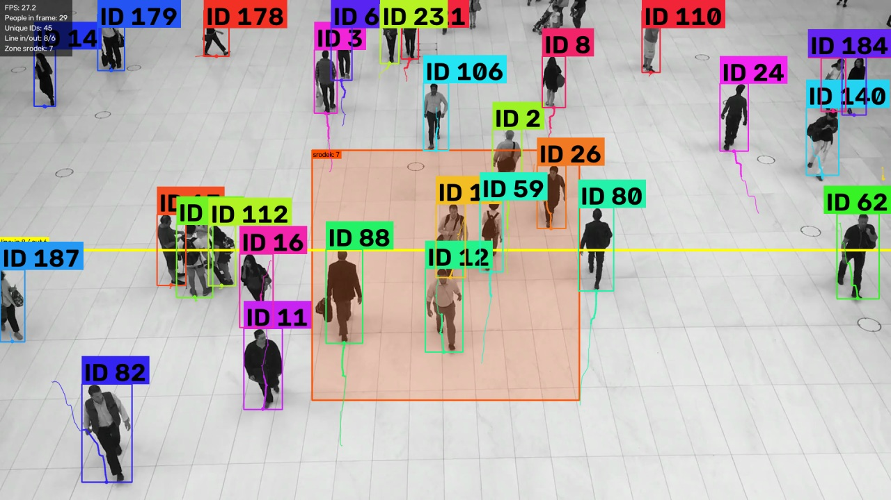
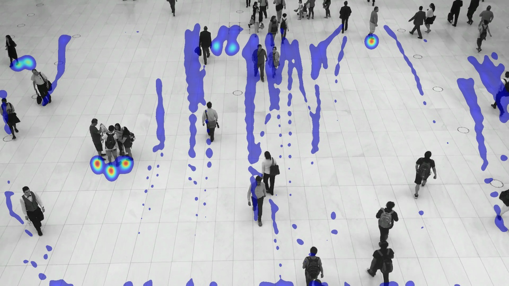

# Wykrywanie, śledzenie i analiza ruchu pieszych

**Autorzy** Daniel Sterzel, Iwo Ropa, Anton Perakhod

Aplikacja wykrywa osoby na obrazie z jednego źródła, śledzi je między klatkami i analizuje ich ruch. Pokazuje trajektorie, tworzy mapę cieplną, zlicza przejścia przez linię i mierzy zajętość stref.

## Uruchomienie

```bash
python -m pip install -r requirements.txt
python videos.py
python -m streamlit run app.py --server.address 127.0.0.1
```

Otwórz [aplikację w przeglądarce](http://127.0.0.1:8501). Wybierz własny plik, nagranie testowe, kamerę komputera lub strumień RTSP. Po wybraniu nagrania testowego aplikacja podpowiada linię, strefę i rozmiar wejścia modelu. Lokalna kamera musi być podłączona do komputera, na którym działa Streamlit. Pierwsze uruchomienie pobiera wagi modelu, jeśli brakuje ich lokalnie.

W trakcie analizy aplikacja pokazuje obraz z adnotacjami, liczniki i FPS. Po zakończeniu lub ręcznym zatrzymaniu można obejrzeć mapę cieplną i wykres liczby osób oraz pobrać trzy pliki CSV.

| Nagranie testowe | Scena | Rozdzielczość | Wejście YOLO |
| --- | --- | --- | ---: |
| `people-walking.mp4` | Hala, widok z góry | 1920 × 1080 | 640 px |
| `market-square.mp4` | Plac z fontanną, widok z góry | 2160 × 3840 | 1280 px |
| `mot17-09.mp4` | Deptak przy sklepach, widok z boku | 960 × 540 | 640 px |

Nagrania pochodzą z materiałów Roboflow Supervision i MOTChallenge. Adresy pobrania oraz ustawienia scen znajdują się w [videos.py](videos.py).

## Algorytmy na przykładach

| Algorytm | Jak działa | Przykład |
| --- | --- | --- |
| **YOLO26** | Model analizuje każdą klatkę. Aplikacja zachowuje wykrycia klasy `person` wraz ze współrzędnymi ramek i ocenami pewności. Korzysta z gotowych wag `yolo26s.pt` wytrenowanych na COCO. | Ramka `(100, 50, 140, 150)` o pewności `0.91` opisuje wykrycie w jednej klatce. |
| **ByteTrack** | Filtr Kalmana przewiduje położenie ramki. Tracker najpierw dopasowuje wykrycia o wyższej pewności, porównując pokrycie ramek (IoU) i pewność. W drugim etapie próbuje podtrzymać pozostałe aktywne ślady za pomocą słabszych wykryć, korzystając z IoU. | Po częściowym zasłonięciu wykrycie o pewności `0.18` może zachować ID 7, jeśli jego ramka wystarczająco pokrywa się z przewidywaną pozycją śladu. |
| **BoT-SORT** | Opcjonalny tracker kompensuje ruch kamery. Domyślna konfiguracja ma wyłączone porównywanie cech wyglądu (ReID). | Gdy kamera przesunie się w bok, tracker może skorygować położenie przewidywanych ramek o przesunięcie obrazu. |
| **Trajektoria** | Pozycja osoby to środek dolnej krawędzi ramki. Kolejne pozycje tego samego ID tworzą ślad. Podgląd rysuje domyślnie 50 ostatnich pozycji, a `tracks.csv` zawiera pełną historię. | Dla ramki `(100, 50, 140, 150)` punkt wynosi `(120, 150)`. Przesunięcie do `(123, 154)` dodaje 5 px do długości śladu. |
| **Mapa cieplna** | Każda pozycja osoby zwiększa wartość w otoczeniu punktu. Filtr Gaussa wygładza sumę, a kolory pokazują intensywność względem maksimum w danym przebiegu. | Jeśli ślad pozostaje w tym samym miejscu przez 25 klatek, program dodaje do mapy 25 obserwacji tego punktu. |
| **Linia zliczająca** | Znak iloczynu wektorowego wskazuje stronę linii. Zdarzenie powstaje, gdy punkt zmienia stronę, a jego ruch przecina wyznaczony odcinek. Każde ID jest liczone najwyżej raz na kierunek. | Gdy pozioma linia jest narysowana od lewej do prawej, ruch w dół przez linię daje `in`, a ruch w górę daje `out`. |
| **Strefy** | Test przynależności punktu do wielokąta wyznacza zajętość i zdarzenia `enter` i `exit`. Punkt na brzegu jest w strefie. Przy braku wykrycia zajętość utrzymuje się przez 15 klatek. | Po wejściu ID 7 do strefy `srodek` zajętość rośnie o 1. Wyjście zmniejsza ją o 1. Obecność w pierwszej klatce również generuje `enter`. |

Domyślnie aplikacja używa ByteTrack z [tracking/bytetrack.yaml](tracking/bytetrack.yaml). Próg detekcji wynosi `0.1`, granica między słabszymi i mocniejszymi wykryciami to `0.25`, a bufor utraconych śladów wynosi 30 klatek. Przy `fuse_score: True` koszt pierwszego dopasowania wynosi `1 − pewność × IoU`, gdzie IoU to pole części wspólnej ramek podzielone przez pole ich sumy. Na przykład pewność `0.9` i IoU `0.6` dają koszt `0.46`, który mieści się w progu `match_thresh: 0.8`. Ostateczny wybór zależy też od innych możliwych dopasowań.

Opis metod i konfiguracji znajduje się w publikacjach i dokumentacji. [YOLO](https://arxiv.org/abs/1506.02640), [ByteTrack](https://arxiv.org/abs/2110.06864), [BoT-SORT](https://arxiv.org/abs/2206.14651), [YOLO26](https://docs.ultralytics.com/models/yolo26/), [śledzenie w Ultralytics](https://docs.ultralytics.com/modes/track/).

## Przykład na nagraniu People Walking

Uruchom analizę z linią w połowie obrazu oraz prostokątną strefą pośrodku kadru.

```bash
python main.py data/videos/people-walking.mp4 --show --heatmap \
  --line 0,0.5,1,0.5 --zone srodek:0.35,0.3,0.65,0.8
```

Polecenie korzysta z ustawień domyślnych `yolo26s.pt` i ByteTrack. W podglądzie klawisz `h` przełącza nakładkę, a `q` kończy analizę. Współrzędne są ułamkami szerokości i wysokości obrazu, gdy wszystkie liczby w danym zestawie mieszczą się w przedziale od 0 do 1. W pozostałych przypadkach program odczytuje je w pikselach. Opcję `--zone` można powtarzać. Dwa punkty wyznaczają przeciwległe narożniki prostokąta, a co najmniej trzy tworzą wielokąt, np. `--zone 'wejscie:0.1,0.2;0.4,0.2;0.35,0.7'`.



*Klatka 170. Żółty odcinek to linia zliczająca, pomarańczowy prostokąt wyznacza strefę, a kolorowe ślady pokazują ostatnie pozycje osób.*



*Mapa po 341 klatkach. Ciepłe obszary wskazują miejsca, w których najczęściej rejestrowano osoby podczas przejść i postojów. W tym przebiegu licznik zarejestrował 11 zdarzeń `in` i 10 zdarzeń `out`.*

### Inne uruchomienia z wiersza poleceń

```bash
python main.py data/videos/market-square.mp4 --image-size 1280 --output wynik.mp4
python main.py 0 --show
python main.py nagranie.mp4 --tracker botsort --show
python -m detection.run_detector nagranie.mp4 --show
```

Ostatnie polecenie uruchamia sam detektor.

W [demo.ipynb](demo.ipynb) są analizy trzech nagrań, wykresy kierunków i prędkości oraz porównanie trackerów. Analiza po przetworzeniu wygładza pozycje średnią ruchomą z pięciu próbek. Prędkość podaje w pikselach lub wysokościach sylwetki na sekundę. Przeliczenie na jednostki fizyczne wymaga kalibracji kamery.

## Pliki wynikowe

Po zakończonym przebiegu program zapisuje wyniki w osobnym katalogu w `data/results/`.

| Plik | Zawartość |
| --- | --- |
| `stats.csv` | Statystyki klatek, w tym liczba śledzonych osób, liczniki linii i zajętość stref. |
| `events.csv` | Przekroczenia linii oraz wejścia do stref i wyjścia z nich, z numerem klatki, czasem i ID śladu. |
| `tracks.csv` | Ramki, ID i pewność wykrycia w kolejnych klatkach. |
| `heatmap.png`, `heatmap_overlay.png` | Mapa cieplna oraz jej nakładka na klatkę. |
| `summary.json` | Ustawienia, podsumowanie liczników, FPS źródła i średnia szybkość przetwarzania. Pole `unique_people` zlicza różne ID śladów. |

## Ocena śledzenia

Jakość oceniono w TrackEval na 525 klatkach MOT17-09 z 26 osobami w oznaczeniach referencyjnych. Współrzędne z pliku MP4 przeskalowano dwukrotnie do rozdzielczości adnotacji, a próg IoU w ocenie wynosił 0,5. IDF1 mierzy zgodność identyfikatorów w całej sekwencji. [MOT17](https://motchallenge.net/data/MOT17/), [TrackEval](https://github.com/JonathonLuiten/TrackEval).

Porównanie modeli wykonano na CPU, z wejściem 640 px i Ultralytics 8.4.213. Oba modele używały ByteTrack z progiem detekcji `0.1`, `match_thresh: 0.8` i `fuse_score: True`. FPS obejmuje detekcję i śledzenie, liczone od drugiej klatki.

| Model | Zmiany ID | IDF1 | Udział dopasowanych ramek referencyjnych | FPS na CPU |
| --- | ---: | ---: | ---: | ---: |
| `yolo26n` | 53 | 53,42% | 66,18% | 60,77 |
| `yolo26s` | 39 | 58,04% | 70,05% | 30,11 |

W osobnej serii z `yolo26n` konfiguracja ByteTrack z progiem 0,8 i włączonym `fuse_score` uzyskała IDF1 53,68% przy 51 zmianach ID. Przy progu 0,9 IDF1 wyniósł 49,41% przy 50 zmianach ID, a po wyłączeniu `fuse_score` 47,90% przy 53 zmianach ID. Na tej podstawie konfiguracja domyślna łączy większy model z progiem 0,8 i włączonym `fuse_score`.

Zasłonięcia i małe sylwetki mogą prowadzić do utraty śladu i nadania tej samej osobie nowego ID. Zmiana ID może rozdzielić trajektorię i wpłynąć na zliczanie. Wyniki jakości dotyczą tej sekwencji, a szybkość całej aplikacji zależy także od sprzętu, rysowania adnotacji i przetwarzania mapy.

## Struktura i testy

| Pliki | Rola |
| --- | --- |
| `app.py`, `main.py` | Interfejs Streamlit i wiersz poleceń. |
| `runner.py`, `pipeline.py` | Obsługa źródła, analiza kolejnych klatek i eksport. |
| `detection/`, `tracking/` | Detektor YOLO i konfiguracja trackerów. |
| `analysis/`, `visualization/` | Analiza ruchu, rysowanie adnotacji i wykresy. |

```bash
python -m unittest discover -s tests -t . -v
```

Testy pokrywają akumulację mapy cieplnej, przejścia przez linię i strefę, eksport wyników oraz obsługę błędnego adresu RTSP. Działają bez pobierania wag modelu.
